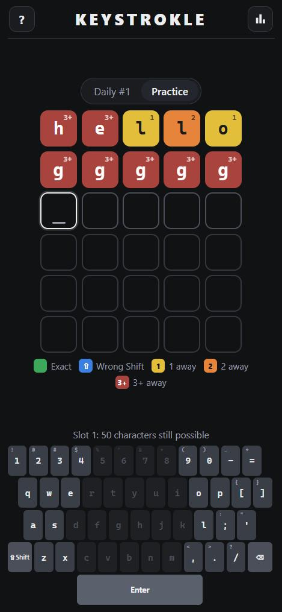

# Keystrokle

**Play it: https://LIVE_URL**

**Status: Finished v1.0, playable.** Daily and practice modes, stats, streaks and sharing all work. Not yet tried by real players.

Keystrokle is a daily guessing game. It works like Wordle, with one big change: every guessed character is coloured by how far its key sits from the right key on a QWERTY keyboard. Guess `g` when the answer is `h` and you get "1 key away". Answers are five characters and can include capitals, digits and symbols, so `Paris`, `don't` and `e=mc2` are all fair game.



## How to play

- Guess the hidden 5-character string in **6 tries**. Any of the 90 playable characters count, and there is no dictionary. Probing the keyboard is the point.
- Each slot gets its own colour:

  | Colour | Meaning |
  | --- | --- |
  | 🟩 Green | Exact character |
  | 🟦 Blue | Right key, wrong Shift (`a` for `A`, `1` for `!`) |
  | 🟨 Yellow | 1 key away |
  | 🟧 Orange | 2 keys away |
  | 🟥 Red | 3 or more keys away |

- **Slots never talk to each other.** There is no "right character, wrong place" colour. Each slot only tells you about its own answer.
- Select a slot (click or tap it, or use the arrow keys) and the on-screen keyboard dims every key that can no longer be that slot's answer. If the only live option needs Shift, the key gets a blue outline and its shifted character is highlighted.
- Type on your real keyboard (Shift works) or use the on-screen one with its ⇧ Shift toggle. Enter submits and Backspace deletes. Slots you have already solved carry into the next row.
- **Daily** gives everyone the same puzzle, which changes at local midnight. **Practice** gives unlimited random puzzles. **Share** copies an emoji grid that doesn't reveal the answer.

### Playable keys

These are the 45 keys of a US QWERTY layout, from `1` to `=` on top and from `z` to `/` on the bottom, plus their shifted characters, for 90 characters in all:

```
1 2 3 4 5 6 7 8 9 0 - =      ! @ # $ % ^ & * ( ) _ +
 q w e r t y u i o p [ ]      Q W E R T Y U I O P { }
  a s d f g h j k l ; '        A S D F G H J K L : "
   z x c v b n m , . /          Z X C V B N M < > ?
```

Backtick, backslash and space are left out. Distance is the number of steps between keys on the physical staggered layout. Two keys are neighbours if they sit side by side in a row, or if they overlap horizontally in the rows directly above and below. For example, `g` borders `f h t y v b`. The game measures steps with a breadth-first search over that graph (`src/keyboard.ts`). Shift doesn't change distance.

## Run it locally

```
npm install
npm run dev        # http://127.0.0.1:5341
npm test           # unit tests
npm run build      # type-check + production build into dist/
npm run simulate   # guess-count simulation (about a minute)
```

The code is Vite plus TypeScript with no framework: about 600 lines of game code and no runtime dependencies.

## Why 6 guesses

`scripts/simulate.ts` plays every answer in the list 20 times (9,200 games per player) with three simulated players. Feedback is per slot, so each slot is an independent search, and a game ends on the turn the slowest slot gets solved.

| Player | What it does | Mean | Median | Wins within 6 | Wins within 7 |
| --- | --- | --- | --- | --- | --- |
| Naive | Picks any still-possible character at random | 6.67 | 7 | 44.9% | 78.6% |
| **Sensible** | Picks a still-possible character, favouring common ones (knows answers are mostly words) | **5.22** | **5** | **90.8%** | 98.5% |
| Greedy | Picks the probe that best splits the remaining options (upper bound on skill) | 4.51 | 4 | 97.8% | 99.8% |

The sensible player finishes on guess 4 in 20.4% of games, guess 5 in 43.1%, guess 6 in 25.7% and guess 7 in 7.7%. With **6 guesses**, it wins 90.8% of the time, and 68.8% of all games end in the last third (guesses 5–6), so 6 matches the target. Seven guesses would make most wins comfortable rather than tense. Full output is in [`docs/simulation-output.txt`](docs/simulation-output.txt).

The simulated players use the keyboard shading perfectly but never guess a whole word from context, so real players may do a little better or worse. The limit is one constant (`MAX_GUESSES` in `src/main.ts`).

## Answers

`src/answers.ts` holds 460 curated answers, enough for more than 15 months of daily puzzles before the cycle repeats:

- 328 everyday lowercase words (`apple`, `storm`, `waltz`)
- 74 with natural capitals: places, months, planets and acronyms (`Paris`, `March`, `NASA!`)
- 58 with symbols or digits: contractions, emoticons, maths and internet shapes (`don't`, `(^_^)`, `e=mc2`, `#love`, `$9.99`)

The daily order is a fixed seeded shuffle, so everyone gets the same answer on the same local date. Puzzle #1 is 2026-11-21. No answer is a brand or trademark.

## Verification

**Automated (Vitest, 27 tests, `npm test`):**
- Keyboard graph: 45 keys and 90 characters, known neighbour sets (`g` borders `f h t y v b`, plus the edge keys `1 = q a z / ' ]`), symmetry, connectivity and known distances.
- Feedback: exact, wrong-Shift, 1, 2 and 3+ marks, plus the absence of any wrong-slot signal.
- Possible-key shading: starts at 90 characters, narrows to the ring around a probe, intersects across rows, and always keeps the true answer possible.
- Answers: all unique, all exactly five playable characters, at least a year's worth, and a real mix of capitals and symbols.
- Daily seeding: local-date day numbers (including across a DST change), stable within a day, no repeats within one cycle, dates before the epoch, and a deterministic shuffle.
- Stats and streaks (including a skipped day and a loss), plus share text that never contains the answer.

**Checked by hand in a browser** (Chromium-based in-app browser):
- Desktop widths (about 660 px and 1280 px) and an emulated 375×812 phone.
- Physical typing of letters, capitals, `!`, `/` and `[`, with Shift, Backspace, Enter and arrow keys.
- The on-screen Shift toggle and the dimming of ruled-out keys, including the case where the answer needs Shift.
- A daily win with the stats dialog, a daily resume after reload, a practice loss with the answer revealed, a new practice puzzle, and copy to clipboard.
- The live Vercel URL returns 200 and plays (see "Deployment").

**Never tested:** real phones and touch input on actual devices, Safari and Firefox, non-US keyboard layouts, screen readers, and real players.

## Known limitations

- Physical typing trusts the character your keyboard sends. On a non-US layout, the keys you press may not match the QWERTY positions the game measures. The on-screen keyboard always works.
- Colour is the main signal. Every scored tile also has a small mark (`⇧`, `1`, `2`, `3+`) for colour-blind players, but no high-contrast theme exists.
- The daily puzzle uses your device's local date, so players in different time zones get a new puzzle at different moments, and changing the device clock changes the puzzle.
- Stats live in your browser's localStorage. Clearing site data or switching devices resets them.
- "3+ keys away" lumps a lot of the keyboard together. That is deliberate (it keeps five colours), but it makes first guesses fairly blunt.

## Story

Zach wanted a Wordle-style daily game where each slot gets graded colour feedback instead of right/wrong. From a few options he picked the keyboard idea: closeness is distance on the physical keyboard, so a near miss literally means your finger was close. He set the playable area (`1` to `=` and `z` to `/`, including both bracket keys), asked for a simulated on-screen keyboard, separate colours for exact, 1 away and 2 away, a distinct colour for right key with wrong case, answers longer than one character, and a simple UI. He also renamed it from "Keystroke" to "Keystrokle" during the build.

His hub planning chat turned that into a design brief: the key set, BFS distance, the five colours, dropping the wrong-slot colour, a curated answer list, choosing the guess count by simulation, and keyboard shading as the main helper. An AI coding agent then built, tested and deployed it in one session.

## AI assistance and Zach's role

AI coding agents built this game. Zach directed it.

- **Zach decided** the concept (keyboard-distance feedback), the playable key area, the on-screen keyboard, the colour scheme for exact, wrong-case, 1 away and 2 away, multi-character answers, the simple UI, the name, and that it should ship publicly.
- **The planning chat (Claude, in Zach's Foundry hub)** turned that into a design brief: 5 colours, no wrong-slot signal, BFS distance, the answer mix, a simulated guess count and possible-key shading.
- **A Claude Code agent (Claude Opus 5.5)** wrote all the code, tests, answer list, simulation and README, checked the game in a browser at desktop and phone widths, and deployed it. Changes it made from the brief:
  - It corrected the key count from 47 keys / 94 characters to 45 / 90, the real count of the keys listed.
  - It hid the keyboard after a game ends so the result fits on screen.
  - It made typing skip slots already solved.
- **Not yet done by Zach:** hands-on play testing and a review of the answer list. The guess count rests on simulation, not on real players.

## Attribution

No third-party assets. The keyboard, icons and favicon are hand-written SVG and CSS, and fonts are system fonts. The only dev dependencies are Vite, TypeScript, Vitest and tsx.

## Deployment

Hosted on Vercel at https://LIVE_URL. DEPLOY_NOTE

## License

No license. All rights reserved; source is public to read.
